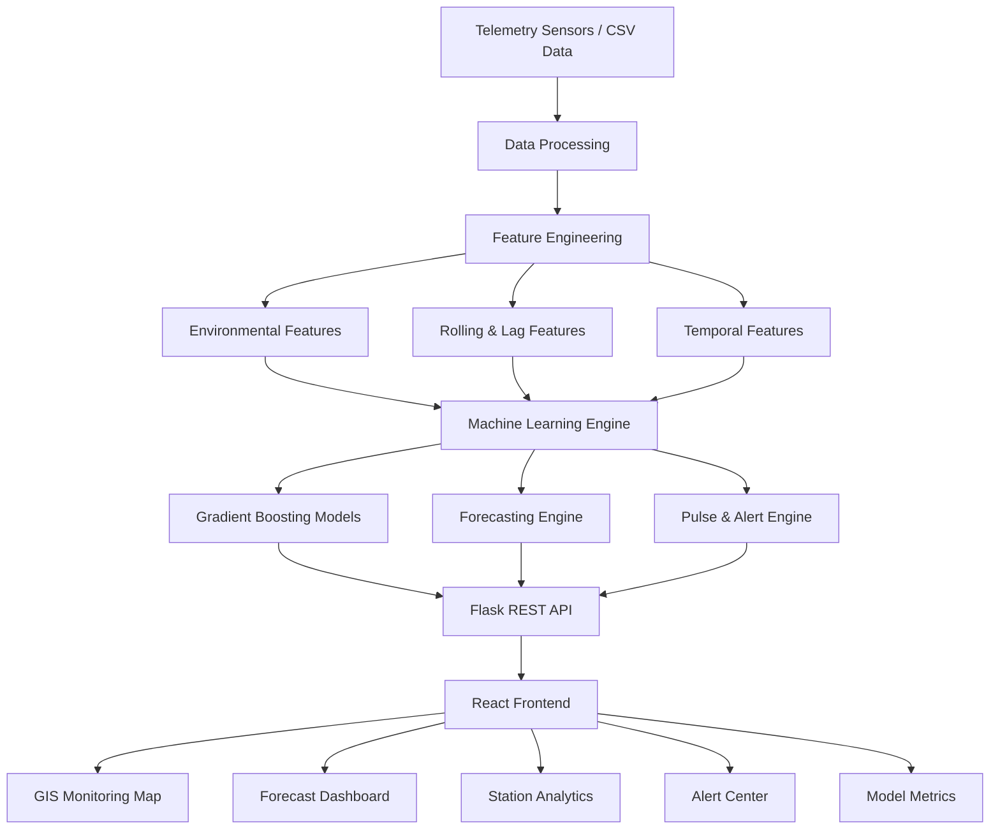

# 🌊 Aquapulse — Real-Time Groundwater Monitoring & Predictive Analytics


> **Aquapulse** is an end-to-end groundwater intelligence platform that combines environmental telemetry, geospatial visualization, machine learning, time-series forecasting, and automated alerting to monitor groundwater conditions in near real time.

The platform is designed to transform raw groundwater and environmental data into actionable insights through interactive dashboards, station-level health indicators, predictive analytics, and spatial monitoring.

---

## 📖 Overview

Groundwater levels are influenced by several environmental factors, including rainfall, temperature, humidity, evaporation, seasonal patterns, and historical water-level variations.

**Aquapulse** brings these factors together into a unified monitoring and prediction system.

The platform processes telemetry data containing:

- 💧 Groundwater levels
- 🌧️ Rainfall measurements
- 🌡️ Temperature
- 💨 Relative humidity
- 📍 Monitoring-station coordinates
- 🕐 Historical timestamps

The processed data is passed through a feature-engineering and machine-learning pipeline to generate groundwater forecasts, rainfall predictions, station health scores, and alerts.

The system currently supports **7-day predictive forecasting**, allowing users to observe both current groundwater conditions and expected short-term trends.

---

# 🎯 Project Objectives

The primary objectives of Aquapulse are:

1. **Monitor groundwater conditions in real time**
2. **Visualize geographically distributed monitoring stations**
3. **Identify abnormal groundwater-level changes**
4. **Predict future groundwater levels**
5. **Forecast short-term rainfall patterns**
6. **Calculate environmental evaporation indicators**
7. **Generate automated station-level health scores**
8. **Provide actionable alerts and advisories**
9. **Expose processed information through REST APIs**
10. **Provide a scalable foundation for future groundwater-management systems**

---

# ✨ Key Features

### 🛰️ Interactive GIS Monitoring

Aquapulse provides an interactive **Leaflet-based GIS map** for monitoring groundwater stations.

Each station can display:

- Current groundwater level
- Station coordinates
- Latest telemetry timestamp
- Station status
- Pulse/health score
- Alert severity
- Historical information

Stations are visually represented using status indicators, making it easier to identify healthy and potentially critical locations.

---

### 🔮 7-Day Predictive Forecasting

The machine-learning pipeline generates short-term forecasts for:

- Groundwater levels
- Rainfall accumulation

The forecasting system combines historical measurements with engineered environmental and temporal features.

Prediction outputs can be visualized directly through the dashboard.

---

### 🧠 Machine Learning Pipeline

Aquapulse uses **Gradient Boosting Regressors** for predictive groundwater and rainfall modeling.

The pipeline includes:

- Data preprocessing
- Missing-value handling
- Feature engineering
- Rolling statistics
- Lag features
- Temporal encoding
- Model training
- Model evaluation
- Model serialization
- Prediction through the Flask API

Pre-trained model artifacts are stored using `joblib` for efficient inference.

---

### 📊 Station Pulse & Health Scoring

Instead of displaying raw groundwater changes alone, Aquapulse converts statistical variations into an easier-to-understand **0–100 station pulse score**.

The system uses statistical analysis, including Z-score-based deviation detection, to identify unusual groundwater behavior.

Station conditions can be classified into multiple levels:

| Level | Meaning |
|---|---|
| 🟢 `NORMAL` | Stable groundwater conditions |
| 🟡 `WATCH` | Minor deviations detected |
| 🟠 `ADVISORY` | Conditions require attention |
| 🔴 `WARNING` | Significant abnormality detected |
| 🚨 `EMERGENCY` | Critical groundwater condition |

This makes the system suitable for monitoring large numbers of stations without requiring users to manually inspect every measurement.

---

### 💧 Water Balance Analytics

Aquapulse combines multiple environmental variables to provide a simplified view of groundwater-related water balance.

The dashboard can compare:

- Average groundwater level
- Rainfall accumulation
- Estimated evaporation
- Historical water-level trends
- Short-term changes

This helps users understand how environmental conditions may be associated with groundwater behavior.

---

### 🌡️ Thermodynamic Evaporation Calculation

The system derives an evaporation-related feature from environmental conditions such as temperature and relative humidity.

A simplified formulation is used:

```text
E = 0.0023 × (T + 17.8) × √(100 − H)
```

Where:

- `E` = estimated evaporation indicator
- `T` = temperature
- `H` = relative humidity

The resulting feature is incorporated into the analytics and prediction pipeline.

---

### ⚡ REST API Backend

The Flask backend exposes modular REST endpoints for the frontend.

The API separates data processing and presentation, allowing the React application to consume lightweight JSON responses.

---

# 🏗️ System Architecture



---

# 🔄 Data & Prediction Workflow

```text
Environmental Telemetry
        ↓
Data Cleaning & Preprocessing
        ↓
Feature Engineering
        ↓
Rolling / Lag / Temporal Features
        ↓
Machine Learning Models
        ↓
Prediction + Statistical Analysis
        ↓
Flask REST API
        ↓
React Dashboard
        ↓
Maps + Charts + Alerts + Metrics
```

---

# 🛠️ Technology Stack

## Frontend

- React 18
- Vite
- JavaScript / JSX
- Tailwind CSS
- Leaflet
- Recharts
- Plotly

## Backend

- Python 3.10+
- Flask
- Flask REST API
- Pandas
- NumPy

## Machine Learning

- Scikit-learn
- Gradient Boosting Regression
- Feature Engineering
- Statistical Analysis
- Time-Series Forecasting

## DevOps & Deployment

- Docker
- Docker Compose
- Git
- GitHub
- Render
- CI workflow

---

# 📁 Repository Structure

```text
Realtime-Ground-water-level-monitoring/
│
├── app.py                         # Flask REST API
├── train_model.py                 # ML training pipeline
├── model.py                       # EDA and standalone analysis
├── Telemetry_data.csv             # Environmental telemetry dataset
│
├── requirements.txt               # Python dependencies
├── runtime.txt                    # Python runtime configuration
├── Procfile                       # Deployment configuration
├── render.yaml                    # Render deployment configuration
│
├── models/
│   ├── gw_model.joblib            # Groundwater prediction model
│   ├── rain_model.joblib          # Rainfall prediction model
│   ├── scaler_X.joblib            # Feature scaler
│   ├── scaler_y.joblib            # Target scaler
│   ├── scaler_X_r.joblib          # Rainfall feature scaler
│   ├── scaler_y_r.joblib          # Rainfall target scaler
│   └── metrics.json               # Model evaluation metrics
│
├── src/
│   ├── App.jsx                    # Main application
│   ├── Home.jsx                   # GIS monitoring interface
│   ├── Dashboard.jsx              # Forecast dashboard
│   ├── Stations.jsx               # Station monitoring
│   ├── Alerts.jsx                 # Alert management
│   ├── Charts.jsx                 # Analytics visualizations
│   ├── ModelMetrics.jsx           # ML metrics
│   ├── Login.jsx                  # Login interface
│   ├── main.jsx                   # React entry point
│   └── index.css                  # Global styling
│
├── public/
│   ├── logo1.png
│   └── ...
│
├── tests/
│   └── test_api.py                # Backend API tests
│
├── Dockerfile
├── docker-compose.yml
├── package.json
├── vite.config.js
├── .gitignore
├── .env.example
└── README.md
```

---

# 🔌 REST API

| Endpoint | Method | Purpose |
|---|---|---|
| `/api/dashboard` | `GET` | Current conditions and 7-day predictions |
| `/api/alerts` | `GET` | Station pulse scores and alert levels |
| `/api/stations` | `GET` | Station metadata and telemetry information |
| `/api/charts` | `GET` | Historical and water-balance analytics |
| `/api/metrics` | `GET` | Model evaluation metrics and feature importance |

Example:

```bash
GET /api/stations
```

Response:

```json
{
  "status": "success",
  "stations": []
}
```

---

# 🤖 Machine Learning

Aquapulse extracts multiple predictive features from the raw telemetry dataset.

### Feature Categories

**Environmental features**

- Temperature
- Relative humidity
- Rainfall
- Estimated evaporation

**Historical features**

- Previous groundwater level
- Previous rainfall
- Lag-1
- Lag-7
- Lag-14

**Rolling features**

- 7-day groundwater mean
- 14-day groundwater mean
- 30-day groundwater mean
- Rolling rainfall accumulation

**Temporal features**

- Month
- Day of year
- Month sine
- Month cosine
- Seasonal indicators

These features allow the models to capture both short-term changes and seasonal behavior.

---

# 📈 Model Performance

Current model evaluation is based on the trained dataset and generated evaluation metrics.

| Prediction Target | Algorithm | R² | RMSE | MAE |
|---|---|---:|---:|---:|
| Groundwater Level | Gradient Boosting Regressor | > 0.92 | ~0.04 m | ~0.03 m |
| Rainfall Accumulation | Gradient Boosting Regressor | > 0.85 | ~1.2 mm | ~0.8 mm |

> **Note:** Model performance can vary depending on the training/test split, dataset size, station coverage, and future data distribution.

---

# 🧪 Testing

Backend APIs can be tested using `pytest`.

```bash
pytest tests/
```

The repository also includes a CI workflow under:

```text
.github/workflows/ci.yml
```

This provides a foundation for automatically validating backend functionality when code changes are pushed to GitHub.

---

# 🚀 Getting Started

## Prerequisites

Install the following:

- Node.js 18+
- npm
- Python 3.10+
- pip

Optional:

- Docker
- Docker Compose

---

## 1️⃣ Clone Repository

```bash
git clone https://github.com/Pardhu643/Realtime-Ground-water-level-monitoring.git

cd Realtime-Ground-water-level-monitoring
```

---

# 🐍 2️⃣ Backend Setup

Create a Python virtual environment:

```bash
python -m venv venv
```

### Windows

```bash
venv\Scripts\activate
```

### macOS/Linux

```bash
source venv/bin/activate
```

Install dependencies:

```bash
pip install -r requirements.txt
```

If model artifacts need to be regenerated:

```bash
python train_model.py
```

Start Flask:

```bash
python app.py
```

Backend:

```text
http://127.0.0.1:5000
```

---

# ⚛️ 3️⃣ Frontend Setup

Open another terminal in the project directory.

Install dependencies:

```bash
npm install
```

Start the Vite development server:

```bash
npm run dev
```

Frontend:

```text
http://localhost:5173
```

---

# 🐳 Docker Deployment

Aquapulse also provides containerization support.

Build and start the services:

```bash
docker-compose up --build
```

This provides a reproducible environment for running the application and its supporting services.

---

# 🌍 Deployment

The project includes deployment-related configuration for cloud hosting.

```text
render.yaml
Procfile
Dockerfile
docker-compose.yml
```

The frontend can also be deployed independently using modern static hosting platforms.

---

# 🔐 Environment Variables

Sensitive configuration should not be committed directly to GitHub.

Use:

```text
.env
```

for local secrets and:

```text
.env.example
```

as a template for required configuration.

Example:

```env
API_URL=http://localhost:5000
```

> Never commit API keys, passwords, database credentials, or private tokens to the repository.

---

# 💡 Real-World Applications

Aquapulse can serve as a foundation for:

- 🌾 Agricultural groundwater monitoring
- 🏘️ Rural water-resource management
- 🏭 Industrial groundwater monitoring
- 🌧️ Drought-risk assessment
- 💧 Water-resource planning
- 🛰️ IoT/DWLR telemetry monitoring
- 📊 Environmental data analytics
- 🏛️ Government groundwater monitoring systems

---

# 🔭 Future Enhancements

Potential improvements include:

### 🌐 Real-Time IoT Integration

Connect directly with DWLR/IoT sensors instead of relying primarily on CSV-based telemetry.

### 🗄️ Centralized Database

Move telemetry storage into PostgreSQL or another production database for scalable historical data management.

### 🤖 Advanced Forecasting

Experiment with:

- XGBoost
- Random Forest
- LSTM
- GRU
- Temporal Fusion Transformers
- Ensemble forecasting

### 🗺️ Multi-District Monitoring

Expand monitoring from individual locations to multiple districts, states, and regional groundwater networks.

### 📱 Mobile Dashboard

Create a responsive mobile application for field engineers and water-resource managers.

### 🚨 Intelligent Alert Notifications

Integrate:

- Email notifications
- SMS
- WhatsApp
- Push notifications

for critical groundwater conditions.

### 🔐 Role-Based Access

Introduce different user roles such as:

```text
Administrator
        ↓
Hydrologist / Analyst
        ↓
Field Engineer
        ↓
General Viewer
```

---

# 📊 Project Highlights

| Area | Implementation |
|---|---|
| Frontend | React + Vite |
| Backend | Python + Flask |
| Machine Learning | Scikit-learn |
| Forecasting | Gradient Boosting / Time-Series Models |
| GIS | Leaflet |
| Visualization | Plotly + Recharts |
| Data Processing | Pandas + NumPy |
| API | REST |
| Testing | Pytest |
| Containerization | Docker |
| Deployment | Render / Cloud-ready |
| Version Control | Git + GitHub |

---

# 🧑‍💻 Skills Demonstrated

This project demonstrates practical experience in:

- Python development
- React development
- REST API development
- Machine learning
- Feature engineering
- Time-series data processing
- Data visualization
- Geospatial visualization
- Statistical analysis
- Model evaluation
- API testing
- Docker containerization
- Git/GitHub
- Cloud deployment
- Full-stack application development

---

## ⭐ Support the Project

If you find Aquapulse useful or interesting:

⭐ Star the repository  
🍴 Fork the project  
🐛 Report issues  
💡 Suggest improvements  
🤝 Contribute to the project

---

> **Aquapulse — Turning groundwater telemetry into actionable intelligence. 🌊**
